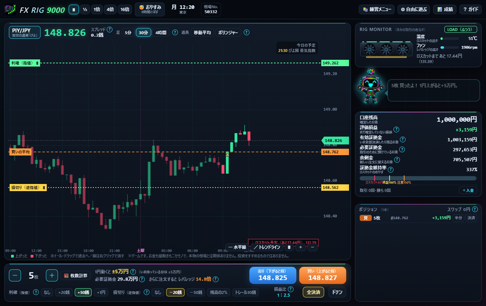
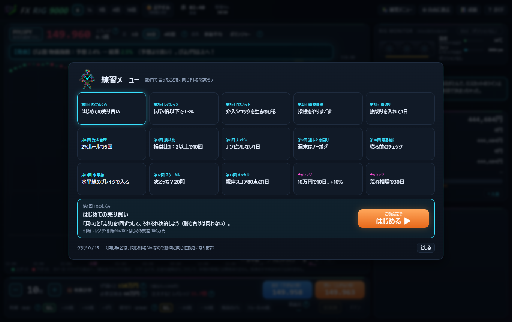

# FX RIG 9000

ゲームのお金で、FX（外国為替証拠金取引）のしくみを体験する Windows 用の練習アプリです。
YouTube の解説動画（ずんだもん・四国めたん）のために作りました。

> **これはゲームです。** お金も値動きもニセモノで、本物の相場とは関係ありません。
> 投資をすすめるものではありません。値動きの「実際の形を参考にしたパターン」も、本物の相場の再現や予想ではありません。

## ダウンロード

右の **Releases**（または [最新版のページ](../../releases/latest)）から `FX-RIG-9000.exe` をダウンロードして、ダブルクリックで開きます。

### 「Windows によって PC が保護されました」と出たら
署名のない個人の作ったアプリなので、はじめて開くときに Windows の警告が出ます。
「**詳細情報**」→「**実行**」で開けます。

- 動くのは Windows 10 / 11 です（Microsoft Edge が入っていれば、追加のインストールはいりません）
- アプリはこの PC の中だけで動きます（インターネットにはつながりません）
- 画面を閉じると、少しして裏のプログラムも自動で止まります

## できること

- 架空の通貨「ぴよ/円」を、ゲームのお金で売り買い（はじめの残高は自分で決められます）
- 本物に近いルール：レバレッジ25倍まで、証拠金維持率でのロスカット（50%＋追証／100% など）、追証、マイナス残高（未収金）、スプレッド、スリッページ、スワップ
- 利確（指値）・損切り（逆指値）・トレール、複数ポジション・両建て・ドテン・半分決済
- 相場のパターン：おまかせ／トレンド／レンジ／指標デー／介入ショック／早朝フラッシュ／荒れ相場（実際の急変の形を参考）、経済指標、週末の窓開け
- チャート：5分・30分・4時間足、移動平均線、ボリンジャーバンド、水平線・トレンドライン
- 枚数の計算機（2%ルール）、「おやすみ」（8時間とばす）、「次どっち？」予想ゲーム
- 練習メニュー15個（動画と同じ「相場No.」で、同じ値動きを練習できます）
- 成績：勝率・損益比・最大ドローダウン・資産のグラフ・負けぐせ診断

## 動画と同じ相場で遊ぶ

「⚙ 自由に遊ぶ」で、相場のパターンと「相場No.」を選ぶと、動画とまったく同じ値動きになります。
例：対決の動画は「荒れ相場」・相場No.「2」。

## ファイル

| ファイル | 内容 |
|---|---|
| `app.html` | アプリの画面（HTML・CSS・JavaScript が1つのファイル） |
| `fxrig.py` | 起動用のプログラム（この PC の中だけで小さなサーバを立て、Edge のアプリ表示で開く） |
| `build.py` / `build.bat` | exe を作るとき用（PyInstaller） |

## クレジット・注意

- アプリの絵（ナビのロボット・背景・アイコン）は画像生成AI（GPT Image / Codex）で作りました。
- このアプリは投資をすすめるものではありません。FX は、預けたお金を上回る損失が出ることがある取引です。
- ロスカットや追証のルールは、国内の会社でよくある設定をまねた説明用で、会社によって少しずつちがいます。
